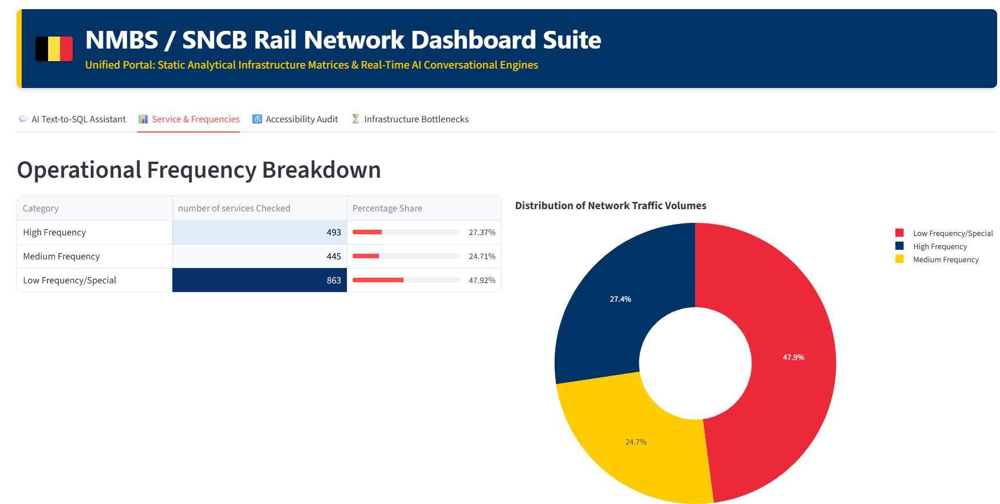
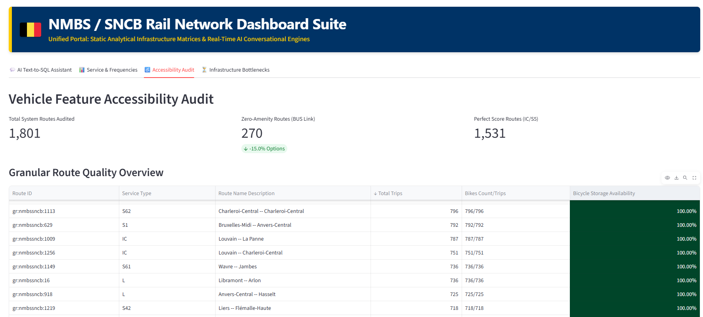
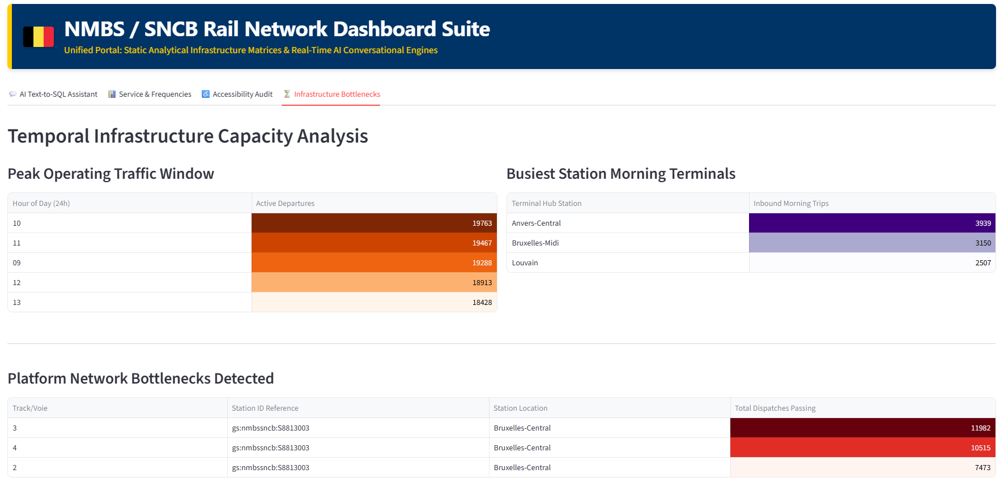
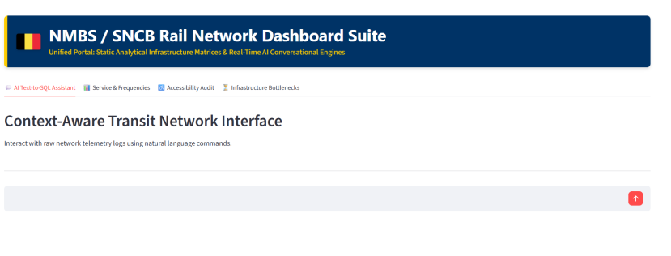
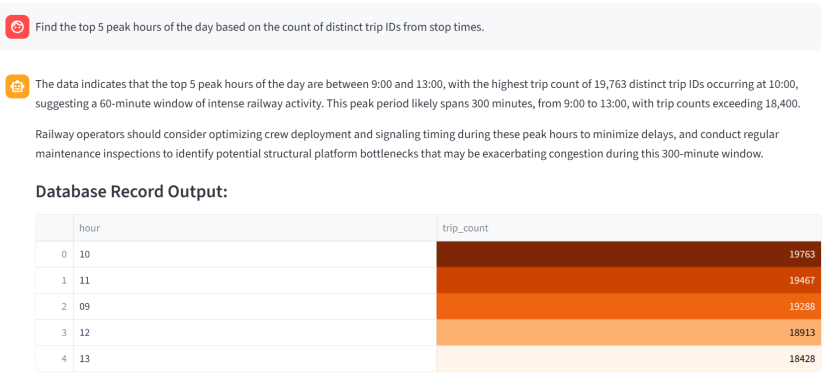
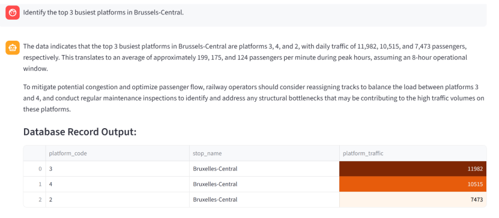
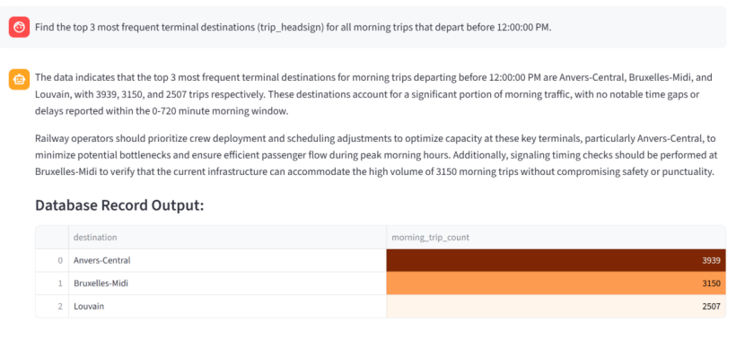
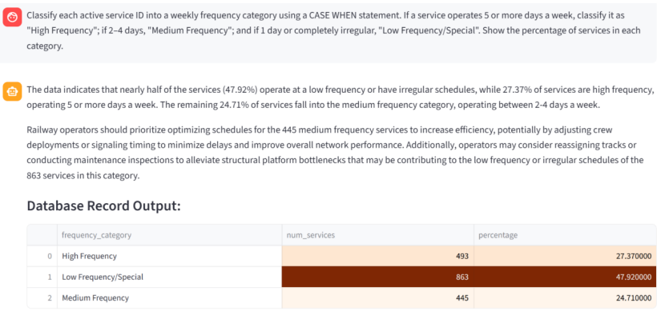

# Railpulse SQL Analysis

The Belgian National Railway company (SNCB/NMBS) wants a clear overview of operational performance and delay patterns to optimize their winter scheduling. This project extracts liveboard data directly from the iRail API, builds a normalized SQLite database, and provides a dashboard for analyzing network bottlenecks, service frequency, and operational risk areas.

## Project Overview

This repository is designed to support railway operations analysis by combining:

- liveboard data collection from the iRail API
- database normalization and SQL-based reporting
- interactive visual analytics
- operational dashboards for planners and analysts

The analysis focuses on:

- peak-hour traffic and scheduled departures
- platform bottlenecks and congested stations
- corridor service frequency patterns
- accessibility and route quality metrics

## Business Goal

SNCB/NMBS needs a clear picture of:

- when delays and congestion are most likely
- which routes and platforms are under pressure
- how service patterns affect operational reliability
- where interventions are needed in winter scheduling

## Tech Stack

- Python
- SQLite
- SQL
- Streamlit
- Plotly
- Pandas
- Matplotlib
- Jupyter Notebook

## Service & Frequencies Tab:

In this rail dashboard, focusing on an **Operational Frequency Breakdown** and the  **Distribution of Network Traffic Volumes** . The data is split into three frequency tiers, with **Low Frequency/Special**

 making up the largest portion of the network at  **863 services checked (47.92%)** , followed by  **High Frequency at 493 services (27.37%)** , and  **Medium Frequency at 445 services (24.71%)** . This breakdown is visualized on the right with a large **donut chart** color-coded in red, dark blue, and yellow to represent each category's respective percentage share

## Accessibility Audit Tab:

This image shows a **rail network accessibility dashboard** for Belgium's national railway company,  **NMBS / SNCB** . The interface tracks specific vehicle features across the network, showing summary statistics for  **1,801 total audited routes** , alongside a detailed breakdown of individual routes. A prominent green data column highlights that every route listed in the table achieves a perfect  **100% availability rate for bicycle storage** .

## Infrastructure Bottlenecks Tab:

**Temporal Infrastructure Capacity Analysis** dashboard tracking peak operating hours, major terminals, and platform bottlenecks across the rail network. The **Peak Operating Traffic Window** table reveals that the highest volume of active departures occurs at  **10:00 (19,763 departures)** , followed closely by 11:00, 09:00, 12:00, and 13:00. Under  **Busiest Station Morning Terminals** , **Anvers-Central** handles the most inbound morning trips at  **3,939** , followed by Bruxelles-Midi and Louvain. Finally, the **Platform Network Bottlenecks Detected** section identifies specific severe constraints at  **Bruxelles-Central (Station ID gs:nmbssncb:S8813003)** , where Track 3, Track 4, and Track 2 handle extreme traffic loads peaking at **11,982 total dispatches** on Track 3.

## AI Text-to-SQL Assistant Tab:

Here NMBS / SNCB Rail Network Dashboard Suite, demonstrating how users can query raw railway telemetry logs using natural language commands.

**SAMPLE QUERY - 1**

* **User Query:** A user submits the prompt: *"Find the top 5 peak hours of the day based on the count of distinct trip IDs from stop times."*
* **AI Analysis:** The system generates an analytical response identifying the peak window as a  **300-minute period from 9:00 to 13:00** **, where trip counts consistently exceed 18,400. It highlights ****10:00 as the single highest peak hour** with 19,763 trips and offers operational optimization advice.

**SAMPLE QUERY - 2**

* **User Query:** The user enters the command: *"Identify the top 3 busiest platforms in Brussels-Central."*
* **AI Analysis:** The system identifies **platforms 3, 4, and 2** as the busiest in the station. It calculates that these platforms handle an average of approximately 199, 175, and 124 passengers per minute respectively during peak hours (assuming an 8-hour operational window). It recommends that operators reassign tracks to better balance the heavy load between platforms 3 and 4.

**SAMPLE QUERY - 3**

* **User Query:** The user enters the command: *"Find the top 3 most frequent terminal destinations (trip_headsign) for all morning trips that depart before 12:00:00 PM."*
* **AI Analysis:** The system identifies **Anvers-Central, Bruxelles-Midi, and Louvain** as the top three destinations, accounting for a massive share of early transit traffic. It suggests that operators optimize crew deployment and perform signaling timing checks at these main hubs (especially Anvers-Central and Bruxelles-Midi) to sustain safety and punctuality under heavy morning loads.

**SAMPLE QUERY - 4**

* **User Query:** The user requests to classify active service IDs into weekly frequency tiers using specific conditional logic: 5+ days a week as  **"High Frequency"** **, 2–4 days as ** **"Medium Frequency"** **, and 1 day or irregular schedules as ** **"Low Frequency/Special"** **, while calculating their percentage share.**
* **AI Analysis:** The system notes that nearly half of all services ( **47.92%** **) fall into the low frequency/irregular category. It advises railway operators to prioritize optimizing schedules for the ****445 medium frequency services** to increase network efficiency and adjust crew deployments.

